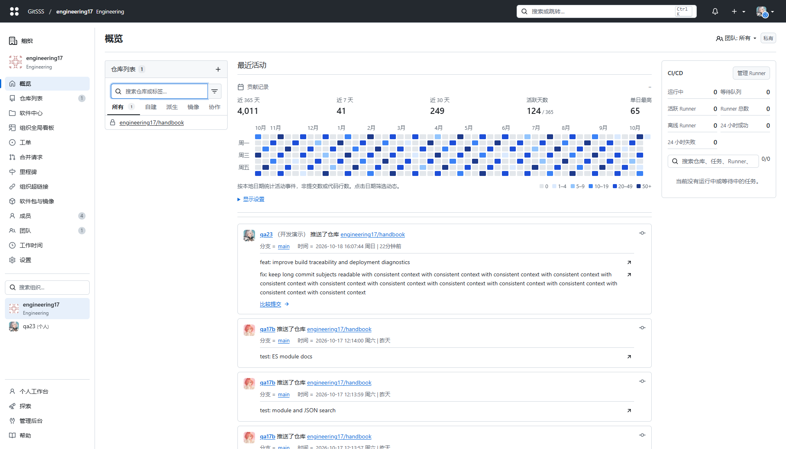
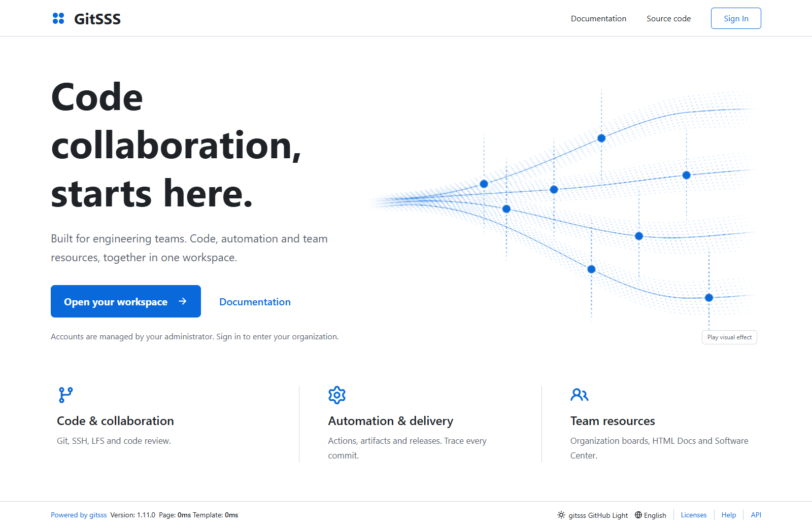
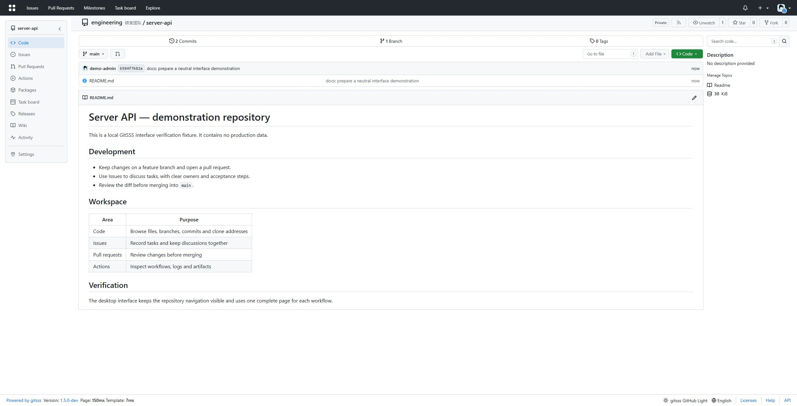
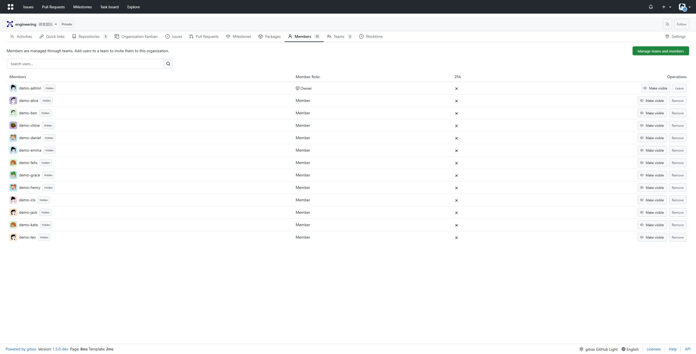
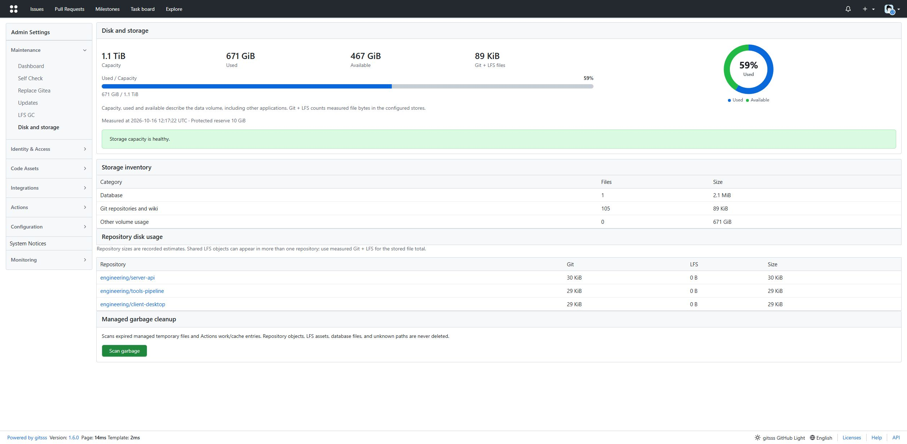
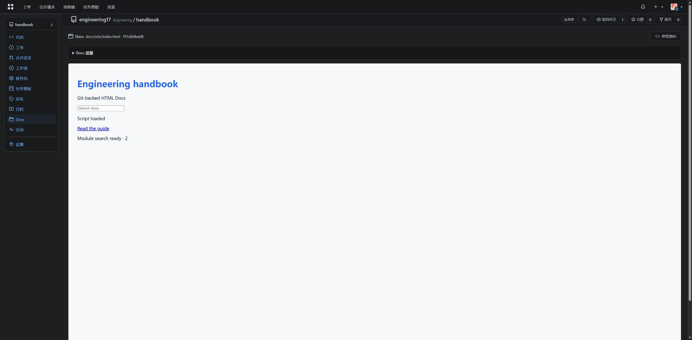
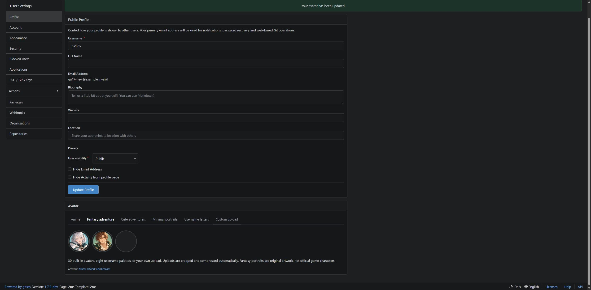
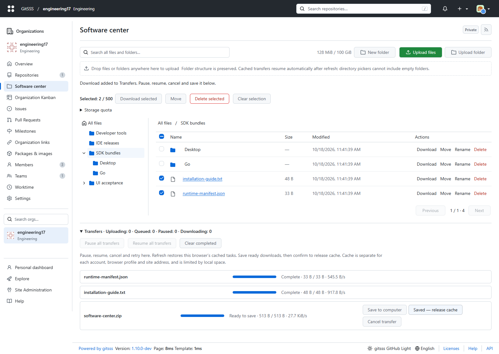
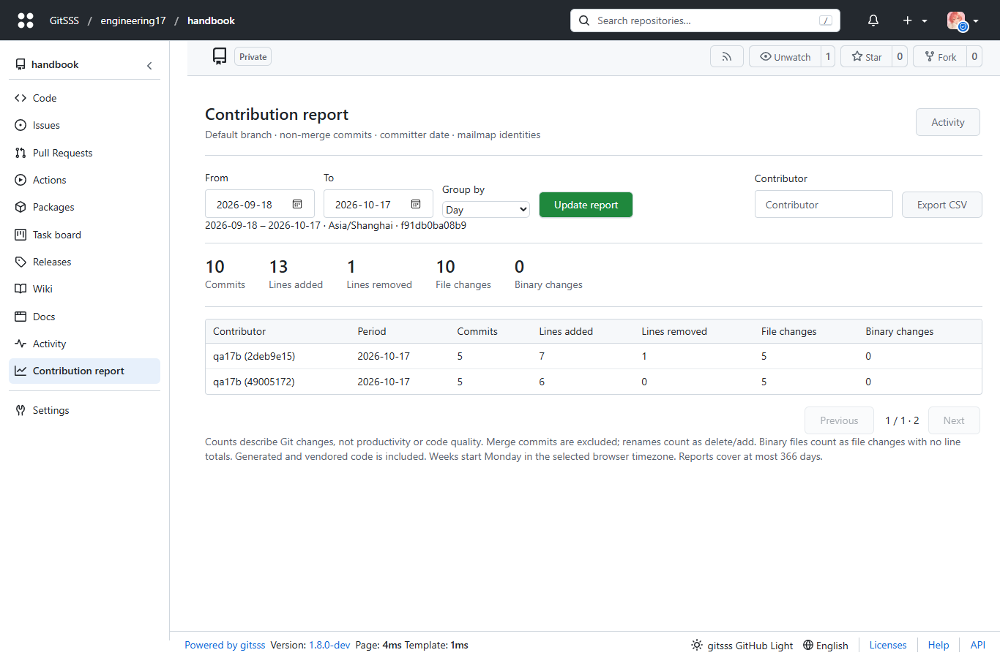

# GitSSS

GitSSS is an organization-first Git collaboration platform for enterprise private networks. It includes Git hosting, issues, pull requests, Actions, packages, releases, wiki, and Git LFS.

[简体中文](README_ZH.md) · [HTML manual](docs/site/en/index.html) · [Enterprise operations](docs/operations/enterprise.md) · [License](LICENSE)

The activity workspace below shows a demonstration instance captured on 2026-10-18; no production repository data is included.



Public entrance, isolated desktop demonstration captured on 2026-10-18:



## Highlights

- A distinct GitSSS entrance with a local shader visual, gray documentation comments, and configurable Google/Feishu/WeChat account binding.
- Global Ctrl+K / ⌘K search, localized date/time pickers, commit-linked Actions trackId and sandboxed per-file HTML preview.
- Readable activity cards with account remarks, separate branch/message fields, and exact local timestamps plus weekday and live relative time.
- Full-width activity calendars with 7/30-day summaries, active-day/peak totals and editable color/count ranges.
- Up to 25 custom repository tags, including Chinese; repository and global search match tags.

- Git over HTTP(S), SSH, and Git LFS.
- Issues, pull requests, reviews, releases, wiki, packages, and Actions.
- An embedded Actions runner, repository file editing, and a compact three-column activity workspace.
- Gitea-compatible HTTP import for accounts, organizations, permissions, repositories, and supported collaboration data.
- Run GitSSS on `5030` beside Gitea on `3000` during evaluation. After an approved cutover, GitSSS can also listen on `3000`.
- Sign-in required and self-registration disabled by default; organizations appear first on the home page.
- Editable team display names, independent of stable team identities and permissions.
- Organization identifiers and editable notes displayed together, searchable by either.
- One complete desktop interface for repository workflows, with readable administration and no classic/new page switch.
- Visible contribution heatmaps with team filtering, and a readable 15px administration overview of volume capacity, usage and measured Git/LFS bytes.
- A consistent organization workspace with searchable organization/team menus and in-place team filtering.
- One shared organization board: quick task cards, search, @member assignment and drag-to-change status; repository boards stay independent.
- Automatic system/browser language, readable desktop themes, and 30 built-in avatars with automatic crop/compression for custom uploads.
- [Repository HTML Docs and eight native notification channels](docs/site/collaboration.html), with isolated rendering, routing policies and provider failure detection.
- Avatar style tabs, username initials and globally unique primary-email editing.
- Compact desktop layouts, a separate Organization links tab, and automatic repository team assignment using organization-owned regex rules.
- Native [Express233 upload](docs/operations/express233-upload.md) from Actions, with streamed uploads and optional publication.





## Native binary installation

Download the matching OS/architecture binary and its `.sha256` from [Releases](https://github.com/neko233-com/gitsss/releases). Verify the checksum before execution. Linux, macOS and Windows binaries run without Docker. Install Git and Git LFS; Node.js is required for JavaScript Actions.

```sh
chmod +x ./gitsss
./gitsss web --work-path /absolute/path/to/gitsss-data
```

On Windows use `gitsss.exe web --work-path C:\gitsss-data`. Open port `5030` and complete the installation form with an administrator password. An existing installation keeps its configuration. The defaults below for a data volume and factory account apply to the Docker installer.

## Docker requirements

- Docker Engine, Docker Desktop, or an OCI-compatible `docker compose` runtime. The included vbox runner can be used without Docker Desktop.
- An offline image archive such as `gitsss-image.tar`, or a locally loaded image.
- Git and Git LFS on the machine that runs the HTTP importer.
- PowerShell 5.1+ on Windows, or Bash on Linux/macOS.

The installer loads local image archives with `--pull never`; it does not pull an image from a registry.

## Defaults

| Setting | Default |
| --- | --- |
| Listen address | `0.0.0.0` |
| Self-registration | Disabled |
| Anonymous browsing | Disabled |
| Web port | `5030` |
| SSH port | `2222` |
| Root URL | `http://localhost:5030/` |
| Initial administrator | `root` |
| Initial password | `root` |
| Data volume | `gitsss-data` |

The initial account is created only for an empty data volume and must change its password at first login. Existing `HTTP_PORT` configuration is retained during upgrades.

## Install

### Linux / macOS

```sh
./install/install.sh \
  --image-archive ./gitsss-image.tar \
  --install-dir /opt/gitsss \
  --port 5030 \
  --root-url http://git.example.internal:5030/ \
  --initial-admin-user root \
  --initial-admin-password 'change-this-password'
```

The installer can configure a `systemd` service on Linux or a per-user `launchd` agent on macOS. Use `--no-autostart` to skip service registration or `--no-start` to stage the installation without starting it.

### Windows PowerShell

```powershell
.\install\install.ps1 `
  -ImageArchive .\gitsss-image.tar `
  -InstallDir C:\gitsss `
  -Port 5030 `
  -RootUrl http://git.example.internal:5030/ `
  -InitialAdminUser root `
  -InitialAdminPassword 'change-this-password'
```

## Gitea migration rehearsal

Keep the source Gitea running. First perform a dry run, review the JSON plan, and import a small repository set into a separate GitSSS data directory. The importer uses Gitea HTTP APIs and Git HTTP; it does not need source filesystem or Docker-volume access.

Store secrets in protected files, not in command arguments or shell history:

```sh
chmod 600 source.password target.password

gitsss import-gitea-http \
  --source-url http://gitea.example.internal:3000 \
  --source-user site-admin \
  --source-password-file source.password \
  --target-url http://gitsss.example.internal:5030 \
  --target-user root \
  --target-password-file target.password \
  --repo team/repository-a \
  --repo team/repository-b
```

Omit `--apply` for the read-only dry run. Add `--apply --credentials-file imported-users.jsonl` to perform the initial import and write temporary passwords for newly created accounts to an exclusive mode-`0600` file.

After the initial import, Git branches, tags, notes, and Git LFS objects can be refreshed without recreating the repositories:

```sh
gitsss import-gitea-http \
  --source-url http://gitea.example.internal:3000 \
  --source-user site-admin \
  --source-password-file source.password \
  --target-url http://gitsss.example.internal:5030 \
  --target-user root \
  --target-password-file target.password \
  --repo team/repository-a \
  --repo team/repository-b \
  --sync-existing-git --apply
```

Incremental sync uses a persistent bare Git cache (by default under the current user's cache directory) so later runs fetch only new objects. It applies source ref deletions and fast-forward updates atomically. A divergent target ref fails safely rather than being force-overwritten. This mode syncs Git refs and LFS objects; it does not continuously sync issues, pull requests, packages, or other repository metadata. See the [migration manual](docs/site/en/index.html#migration) for scope and acceptance checks.

## Two-port evaluation

Run GitSSS on `5030` alongside the existing Gitea on `3000` during evaluation. Wait for the operator's explicit cutover instruction. Preserving existing credentials, Actions history and all metadata requires a stopped native database/data takeover using the original storage paths; the HTTP pilot alone is insufficient. See the [cutover procedure](docs/operations/gitea-http-import.md#two-port-evaluation-and-later-cutover). After native acceptance and Gitea releases `3000`, add it from **Admin → Gitea takeover** or `POST /api/v1/admin/listen-port/alias` with `{"port":"3000"}`. Both ports serve the same accepted data, and the public root URL becomes `3000`. Operating-system SSH credentials and port 22 stay unchanged.

For Docker deployments, publish the additional host/container port and recreate the container before adding the alias. The listener change itself is live for native installs and containers that already publish both ports.

## Documentation

- [English HTML manual](docs/site/en/index.html)
- [简体中文 README](README_ZH.md)
- [Configuration](docs/site/configuration.html)
- [Gitea migration operations](docs/operations/gitea-http-import.md)
- [Architecture and compatibility](docs/site/architecture.html)
- [Offline production operations](docs/operations/offline-production.md)

## Development

Run `task help` to list development targets. Common checks include `task fmt`, `task lint:go`, `task lint:js`, `task test:go`, and `task test:js`. Do not add GitHub Actions workflows; this repository does not use GitHub Actions as a release gate.

The offline HTML manual is bundled at `/help/` (English default). Native Actions runners require Git, Git LFS and Node.js. Operator commands: `tools/verify-git.py`, `tools/agent-ops.py`, and `tools/rehearse-native.py`; use `--help` for their inputs.



HTML Docs and avatar styles, captured from an isolated demonstration instance on 2026-10-17.





## Organization workspace and centers

- One desktop navigation rail, organization-first landing, global search and keyboard access.
- A tree-based organization software center: 100 GiB default quota, drag-and-drop files/folders, resumable uploads, batch ZIP downloads, moves, search and content deduplication.
- Native Docker/OCI registry using existing package permissions and storage.
- Per-repository daily, weekly and monthly contribution reports with CSV export and explicit counting rules.

Desktop center screenshots from the isolated demonstration instance, captured on 2026-10-18.





See the [centers manual](docs/site/workspace-centers.html) and [compatibility report](docs/features/workspace-centers.md).

Software center transfers support file/folder pickers, drag-and-drop, nested directories, atomic moves and batch deletion. Uploads and downloads share one transfer panel with progress, speed, pause, resume, cancel and retry. Browser-local IndexedDB caches sources and received 8 MiB ranges for automatic refresh/restart recovery in the same profile, account and origin. Completed downloads are saved from the panel; confirm saving to release their cache. Browser quotas and eviction can limit recovery. Virtual ZIP64 batches create no extra archive on the server. Read the [transfer API, cache limits and rollback contract](docs/features/software-center-transfers.md).
